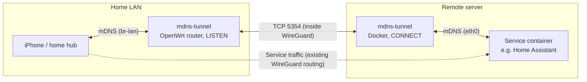

# mdns-tunnel

A relay that forwards only the mDNS packets you need over [WireGuard](https://www.wireguard.com/) (or any other L3 tunnels).

## Why

mDNS packets do not pass through WireGuard on their own.

It was built to expose the Home Assistant HomeKit Bridge (`_hap._tcp.local`) to iPhones and home hubs, but it works with other mDNS services too!

## How it works



## Features

- **Service filtering:** forwards only the mDNS packets related to the configured services through the tunnel.
- **Address rewriting:** replaces the address in A records with the server's WireGuard IP, so LAN devices connect to an address they can actually reach instead of the container's internal address.
- **Automatic reconnect:** when the tunnel drops, the connecting side reconnects on its own.
- **Small footprint:** ships as static binaries for `aarch64` and `x86_64` and as a `scratch`-based image. (Docker image is <1MB)

## Installation

### Server (Docker Compose)

#### Example:

```yaml
services:
  mdns-tunnel:
    image: ghcr.io/mokyabun/mdns-tunnel:release
    container_name: mdns-tunnel
    network_mode: "service:homeassistant" # compose service name of the service to share
    environment:
      IFACE: eth0
      CONNECT: "<router WG IP>:5354"
      SERVICES: _hap._tcp.local
      ADVERTISE_IP: "<server WG IP>"
    restart: unless-stopped
```

`IFACE` is the interface name as seen inside the service container. You can find it with `docker run --rm --network container:<container name> alpine ip addr`.

```sh
docker compose up -d mdns-tunnel
```

### OpenWrt

Download the package for your OpenWrt version from [Releases](https://github.com/mokyabun/mdns-tunnel/releases) and install it on the router.

Packages are currently built only for `aarch64_cortex-a53`. ([More planned](./docs/WIP.md))

```sh
scp -O <package> root@<router>:/tmp/                                   # run on your PC

opkg install /tmp/mdns-tunnel_<version>-r1_aarch64_cortex-a53.ipk      # OpenWrt 24.10
apk add --allow-untrusted /tmp/mdns-tunnel-<version>-r1.apk             # OpenWrt 25.12
```

## Usage

Enable the relay on the router. If your WireGuard interface is not named `wg0`, set `listen_network` as well.

```sh
uci set mdns-tunnel.main.listen_network=<wg interface>   # only if not wg0
uci set mdns-tunnel.main.enabled=1
uci commit mdns-tunnel
service mdns-tunnel reload
```

The tunnel is up when both logs show `tunnel up with <peer>`.

```sh
logread -e mdns-tunnel          # router
docker logs -f mdns-tunnel      # server
```

## Documentation

- [Configuration](docs/configuration.md): the server's environment variables and the router's UCI options.
- [Development](docs/development.md): how to run the CI checks locally.

## License

[MIT](LICENSE)
